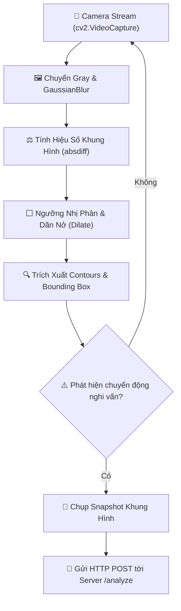

<div align="center">

# 🚭 SMOKE & SMOKING ACTION DETECTOR 🚭
### 🎥 Computer Vision Motion Analysis & Cloud-Based Smoking Detection System
*Hệ Thống Camera Giám Sát Phát Hiện Hành Vi Hút Thuốc Lá Thời Gian Thực & Tự Động Cảnh Báo*

[](https://python.org)
[](https://opencv.org/)
[](https://github.com/baolam/smoke)

---

</div>

> [!IMPORTANT]
> **Smoke & Smoking Action Detector** là hệ thống thị giác máy tính giám sát tại các khu vực cấm hút thuốc (bệnh viện, trường học, trạm xăng). Khi phát hiện chuyển động nghi vấn đưa tay lên miệng, hệ thống tự động chụp ảnh khung hình và gửi tới máy chủ phân tích chuyên sâu để kích hoạt cảnh báo.

---

## 📑 Mục Lục (Table of Contents)
- [✨ Tính Năng Nổi Bật](#-tính-năng-nổi-bật)
- [🏗️ Sơ Đồ Luồng Hoạt Động](#️-sơ-đồ-luồng-hoạt-động)
- [📂 Cấu Trúc Dự Án](#-cấu-trúc-dự-án)
- [⚙️ Công Nghệ Sử Dụng](#️-công-nghệ-sử-dụng)
- [🚀 Hướng Dẫn Cài Đặt & Khởi Chạy](#-hướng-dẫn-cài-đặt--khởi-chạy)
- [📜 Giấy Phép (License)](#-giấy-phép-license)

---

## ✨ Tính Năng Nổi Bật

| Biểu Tượng | Tính Năng | Mô Tả Chi Tiết |
| :---: | :--- | :--- |
| 📹 | **Phân Tích Chuyển Động Vi Sai** | Áp dụng kỹ thuật Absolute Difference và Gaussian Blur phát hiện các chuyển động cục bộ vùng mặt. |
| ⚡ | **Lọc Nhiễu Bằng Ngưỡng Nhị Phân** | Sử dụng phép toán dãn nở (Dilation) và lọc diện tích contour để loại bỏ nhiễu rung lắc môi trường. |
| ☁️ | **Tự Động Bắn Dữ Liệu Lên Cloud** | Tự động snapshot khung hình vi phạm và gửi gói tin HTTP multipart đến máy chủ phân tích `/analyze`. |
| 🔔 | **Tối Ưu Hóa Tần Suất Gửi** | Cơ chế định thời chu kỳ cập nhật static frame giúp giảm tải đường truyền và tài nguyên CPU. |

---

## 🏗️ Sơ Đồ Luồng Hoạt Động



---

## 📂 Cấu Trúc Dự Án

```bash
smoke/
├── 📄 index.py            # Kịch bản chính thu nhận camera, phân tích chuyển động và gửi cảnh báo
├── 📄 requirements.txt    # Danh mục thư viện phụ thuộc (OpenCV, Requests)
└── 📄 README.md           # Hướng dẫn chi tiết dự án
```

---

## ⚙️ Công Nghệ Sử Dụng

- **Computer Vision**: OpenCV (Motion Detection, Contour Tracking, Morphological Operations)
- **Networking**: Requests, HTTP Multipart Upload, Cloud API
- **Language**: Python 3.8+

---

## 🚀 Hướng Dẫn Cài Đặt & Khởi Chạy

```bash
# 1. Clone repository
git clone https://github.com/baolam/smoke.git
cd smoke

# 2. Cài đặt thư viện
pip install opencv-python requests

# 3. Chạy hệ thống giám sát
python index.py
```

---

<div align="center">

## 📜 Giấy Phép (License)

Dự án được phân phối dưới giấy phép **MIT License**.

---
**Made with ❤️ by [Bảo Lâm](https://github.com/baolam)**

</div>
